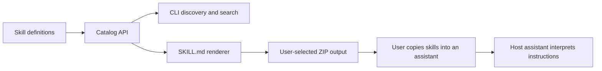

# Architecture

GNCore is a Python skill catalog and portable content tool. Its runtime does not orchestrate AI models or interact with assistant applications.

## Package boundaries

- `skills/domains.py` defines the curated 30 domain packs.
- `skills/library.py` builds the built-in catalog, search index, and validation behavior.
- `skills/models.py` contains the immutable skill and domain data types.
- `cli/app.py` implements catalog listing, search, inspection, version display, and explicit ZIP export.
- `scripts/generate_skill_catalog.py` derives the human-readable catalog from the Python definitions.

The CLI has no application adapters, application path detection, persistent settings, install/uninstall routines, backups, MCP configuration, subprocess integrations, or model orchestration. Export is the only command that writes a file, and it writes only to the output path given by the caller.

## Portable skill format

Each exported skill is a standard directory containing one `SKILL.md` file. The document starts with `name` and `description` YAML frontmatter, then contains the skill title, goal, and instructions. The folder name and `name` field use the stable skill ID, which also serves as the slash-invocation name in assistants that support it.

## Adding a skill

Add a validated definition to the catalog or a ten-workflow domain pack in `skills/domains.py`. Use a stable lowercase hyphenated ID, concise discovery description, relevant tags, and instructions specific to the workflow. Regenerate the catalog and run the tests. Skills describe work for a host assistant; they do not execute code on their own.
