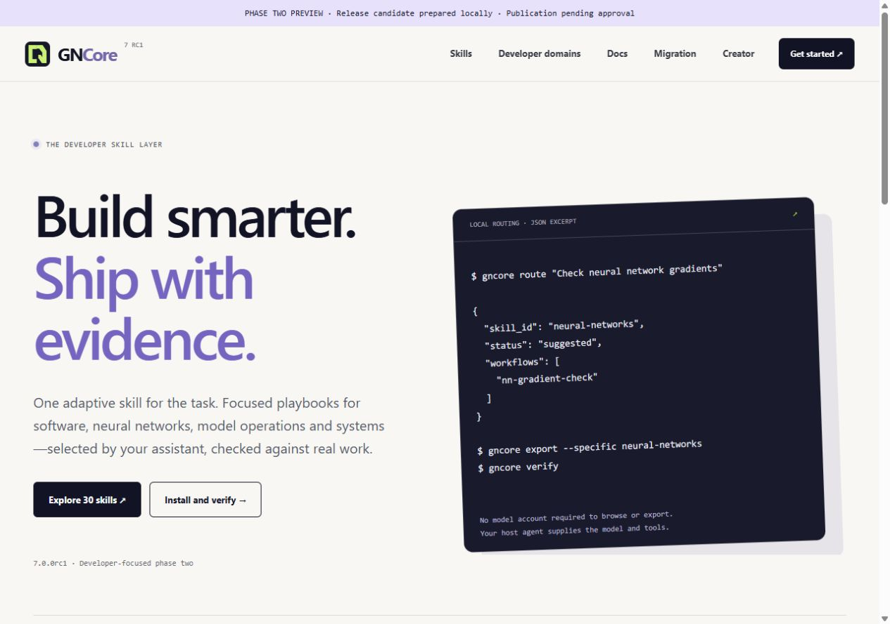
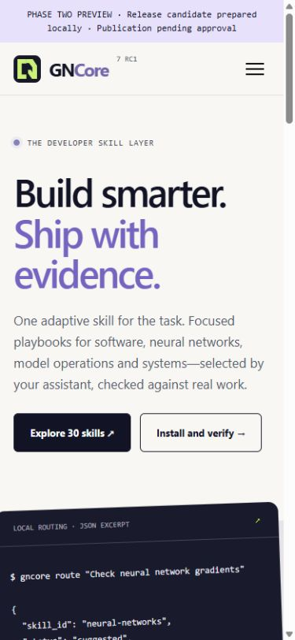

# Phase-two verification evidence

Candidate: **7.0.0rc1**. Prepared locally; GitHub source/release publication, PyPI upload and live website deployment await the owner’s requested approval.

| Check | Observed result |
| --- | --- |
| Full suite on Windows, Python 3.10.20 | 134 passed, 1 skipped |
| Full suite on Windows, Python 3.12.13 | 134 passed, 1 skipped |
| Full suite on Windows, Python 3.14 | 134 passed, 1 skipped |
| Native skill format | 30 source and 30 installed entrypoints valid |
| Phase-one accounting | All 553 workflow IDs accounted for: 203 preserved, 116 rewritten, 234 retired |
| New original workflows | 55; 374 active workflows in 30 developer categories |
| Repeated procedure groups | 22 earlier groups replaced; no identical active procedures remain |
| Resource audit | 1,630 declared files verified; entrypoint links and procedure hashes match |
| Supporting Python syntax | 73 helper files parsed; imported helpers not generally executed |
| Local project migration | 12 categories added, 18 updated, 42 pristine old folders retired with backup |
| Installed file inventory | 1,660 tracked files intact, no missing/modified/unmanaged files |
| Evaluation coverage | 90 concrete scenarios, three per active category; schema/references validated |
| Website static graph | 41 HTML pages, 1,796 local references and 672 redirects checked |
| Browser behavior | Search, domain filter, empty/reset state, narrow/wide layout and menu Escape recovery observed |
| Neural-network probe | All analytic gradients checked; tiny CPU XOR learning and checkpoint continuation verified |

The skipped test requires creating a symlink, unavailable to this Windows account. A parallel run surfaced transient Windows directory locks; bounded retries now cover those errors, and a permanent-denial regression still fails after its bounded attempts while preserving original files.

The CPU probe’s observed initial loss was 0.8306873886, final loss 0.0012142257 after 2,500 steps, and maximum relative finite-difference gradient error about 1.69e-8. This is a synthetic mechanics check, not production training evidence.

Clean artifact verification compares the built wheel/source runtime, isolated wheel import, exported skill ZIP, actual project installation and preserved original reference bytes. The prepared artifact directory contains the wheel, source archive, skill ZIP, `SHA256SUMS` and a machine-readable verification record. Metadata checks and exact byte comparisons are required before publication approval is requested.

## Browser evidence

The actual local site was inspected at desktop and mobile widths with no horizontal page overflow. Search for “neural network” returned one category; an unsupported query showed the empty state; Systems and Performance filtering showed four categories. Copy feedback and the intended command metadata were observed; the browser clipboard bridge returned no readable contents, so exact clipboard read-back is not claimed. An Escape-key aria-label mismatch in the inherited menu script was fixed and rechecked.

## Boundaries

The 90 scenarios are defined and structurally validated; their complete agent outputs have not all been executed or blindly reviewed. Real GPU/framework training, cloud/device operations and every upstream helper dependency are not certified. The new GitHub CI matrix is configured for Windows/macOS/Linux and Python 3.10–3.14 but has not run remotely because source publication is held for approval. The live Cloudflare site is unchanged.

See [the merge ledger](PHASE2_MERGE_AUDIT.json), [migration guide](../MIGRATION.md) and [release plan](PHASE2_RELEASE.md).
