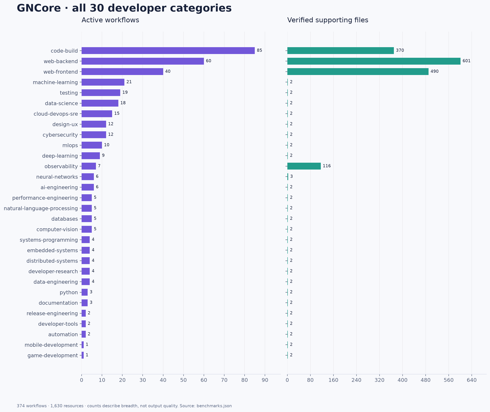
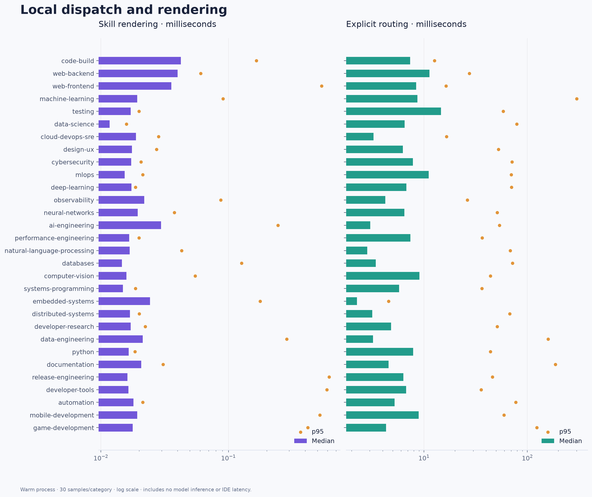
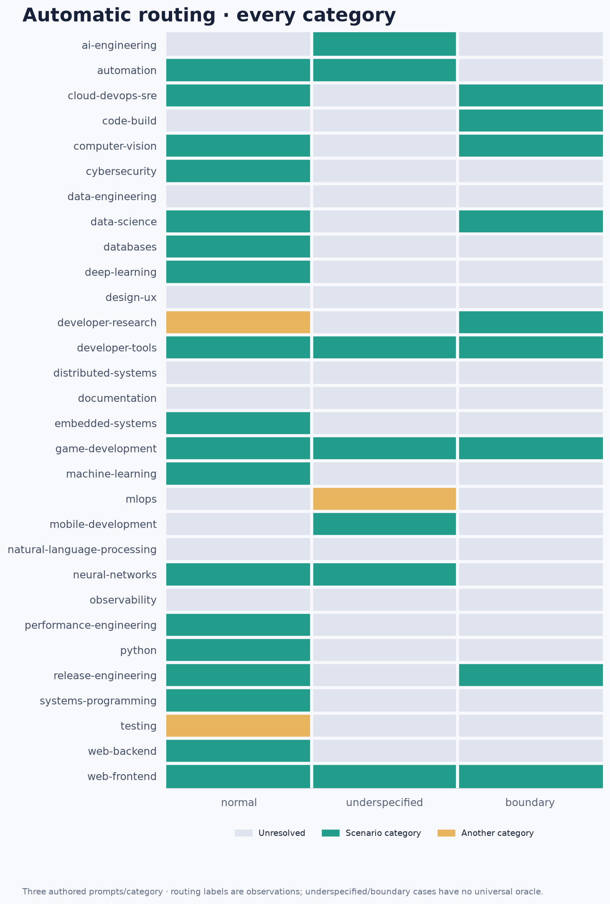
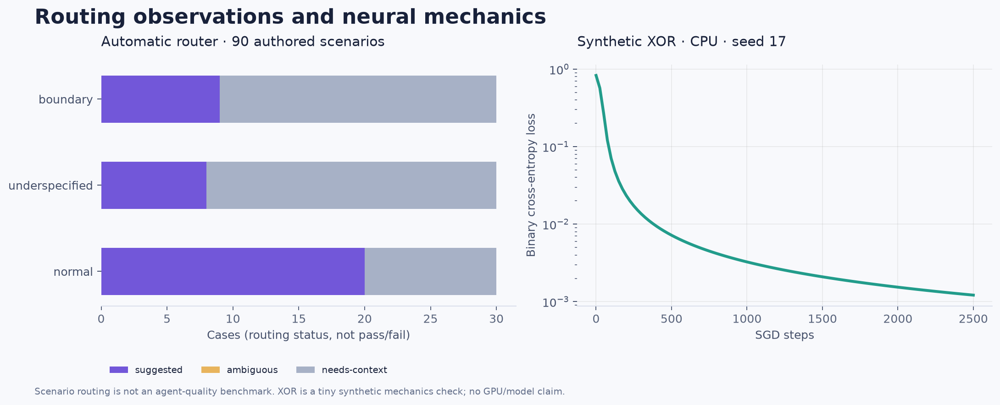

# GNCore local benchmark evidence

This directory stores the GNCore 7.0.0rc1 local test evidence requested on 29 October 2026. Measurements cover all 30 developer categories. These are catalog, installation, routing and local runtime measurements; they do not establish an agent's ability to complete every developer task.

## Reproduce

Install the candidate into an isolated Python environment, then install Matplotlib from `requirements.txt`. From the repository root:

```powershell
$env:PYTHONPATH = 'src'
python scripts/benchmark_categories.py --output web-results --repeats 30
```

To redraw the same measurements without rerunning them:

```text
python scripts/benchmark_categories.py --output web-results --plot-only
```

`benchmarks.json` retains every timing sample, source fingerprints, environment details, 90 automatic routing observations and the synthetic neural-network probe. `categories.csv` provides the category measurements. The `charts` directory contains Matplotlib PNG and editable SVG exports.

Each latency operation has one excluded warm-up. Reported median and nearest-rank p95 use 30 timed in-process samples; resource reads use five. Filesystem caches, OneDrive activity and other applications are uncontrolled. These timings cannot compare IDE speed or model performance.

The three scenario kinds per category are normal, underspecified and boundary. Their category labels provide intended context; an ambiguous request need not resolve automatically. Routing outcomes are recorded without equating a keyword match with successful task execution. The scenarios are authored alongside the catalog and are not a held-out benchmark.

IDE checks and their exact boundaries are recorded separately in `ide-results.json` and the final results report. Screenshots and transcripts must contain only the GNCore test workspace. Authentication, model availability, native skill discovery and completed agent work must each be reported from observation; opening a Markdown file alone does not prove agent integration.

See [the measured results](RESULTS.md), [IDE evidence](ide-results.json), [raw samples](benchmarks.json) and [category CSV](categories.csv).









The neural probe uses a tiny CPU-only XOR network. Its learning curve and gradient check test numerical mechanics; they do not benchmark production ML training, GPU support or large models.

Publication to GitHub, PyPI and the live website remains subject to the owner's requested approval.
